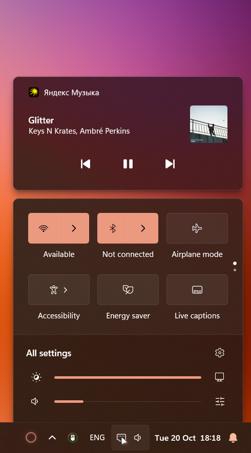

# Refined Quick Settings and Sound

[Русский](docs/README.ru.md)



This "vanilla+" Windhawk mod reworks the Windows 11 "Quick Settings" and "Volume mixer" panels and makes them fit for daily use. It follows the Windows 11 design language, refining existing features and adding new ones: thin sliders, even row spacing at every display scale and a smooth frame transition to the Sound page.

Everything runs inside the shell's own panels (ShellHost): no extra windows, the system Acrylic, fonts, themes, lists, bindings and animations are kept, and customizations are restored when the mod is unloaded.

## Features

**Quick Settings**

- Brightness control for DDC/CI-compatible displays, with animated glyphs.
- Press the brightness glyph to toggle night light on and off.
- Open display settings directly from the glyph on the right side of the slider.

**Sound**

- The "Sound output" page is now simply "Sound".
- Change the output and input devices and the spatial sound provider from dropdown lists.
- Below them, a reworked Volume mixer for the apps. It is collapsible and remembers its last state.
- Mouse wheel on every slider; press an app's icon to mute and restore it, or its volume number to set it to 100.
- Hide apps from the mixer by name (mod setting).

**Taskbar**

- Click the volume icon to open Sound directly.
- The system's animated volume glyph and an Ethernet glyph for wired networks.

Mod ID: `refined-quick-settings-and-sound`. The version is in `mod/sound-native.wh.cpp`.

## Compatibility

Windows 11 24H2 or later (Quick Settings hosted by ShellHost), x86-64 (ARM64 is untested). Development testing was performed on build **26300**, primarily at **125%** display scale. Other builds and scales need validation; this mod depends on internal shell XAML elements and symbols that Windows updates can change. Added labels such as “Sound” and “Input device” are in English. DDC/CI brightness requires a compatible monitor with DDC/CI enabled in its settings.

The mixer starts collapsed on the first Sound opening in each ShellHost process; subsequent openings remember its state. Disable other mods or styling rules that modify the same Quick Settings, Sound or taskbar volume elements.

Control Center discovery uses COM-interface symbol hooks in ControlCenter.dll and the public XAML visual tree; it does not open a XAML Diagnostics connection. Compatibility with other mods that edit the same controls still requires live testing. If the panel was already open when enabling this candidate, close and reopen it; restart ShellHost if it is not picked up.

## Installation from source

1. Install [Windhawk](https://windhawk.net/).
2. Download `mod/dist/refined-quick-settings-and-sound.wh.cpp` from this repository.
3. In Windhawk, create a new mod, replace the template with the downloaded source, then compile and enable it.
4. If the panels do not update, restart ShellHost. Windhawk logs contain diagnostic errors.

No prebuilt DLL is required. Open Quick Settings with Win+A and Sound with Win+Ctrl+V or the taskbar volume icon.

The repeatable mouse demo recorder is documented in [docs/PREVIEW.ru.md](docs/PREVIEW.ru.md).

## Building

Requires Python 3 and an installed Windhawk (`build.ps1` uses `C:/Program Files/Windhawk/Compiler` and Engine 1.7.3; adjust the paths for another installation).

```powershell
cd mod
.\build.ps1
Stop-Process -Name ShellHost -Force
```

`build.ps1` first runs `package.py`, which assembles `mod/dist/refined-quick-settings-and-sound.wh.cpp`, a single file for the Windhawk editor. Edit the sources in `mod/`, not `dist`. Property-interface tests: `mod/test-model.ps1` (these do not test the shell UI). Panel opening timing: `tools/measure-panel-open.ps1`.

## Licenses

The mod is [GPL-3.0-only](LICENSE). The UI-thread dispatch technique follows m417z's Notification Center Styler (GPL-3.0); the hidden-apps parser is adapted from the Sound Output Direct and Taller mod. Lucide icons are ISC licensed, see [third-party notices](docs/THIRD-PARTY-NOTICES.md) and `mod/LUCIDE-LICENSE.txt`.
